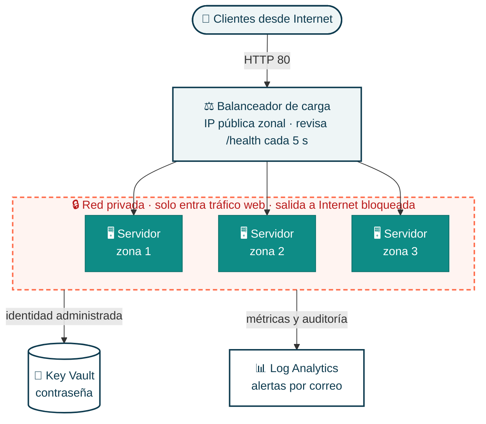
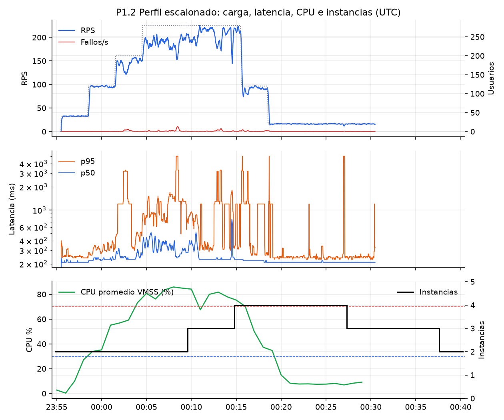
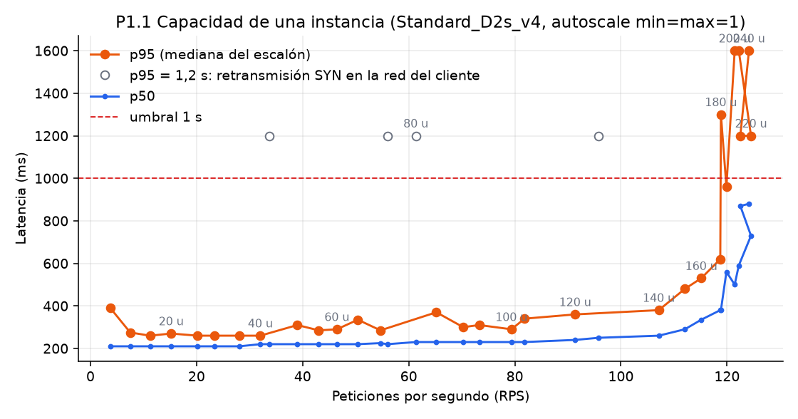
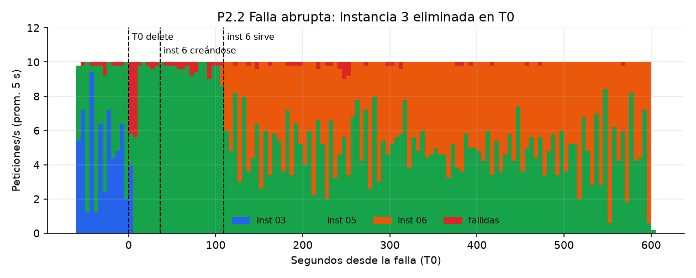
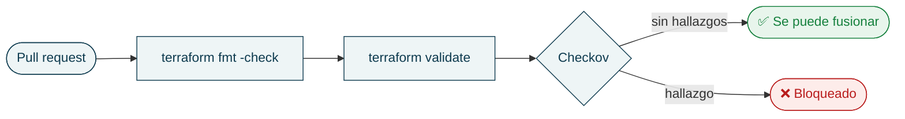

<div align="center">

# 🏝️ CaribeShop en Azure

**Plataforma segura, escalable y altamente disponible, desplegada 100 % como código**

[](https://github.com/AgEnt3P18/caribeshop-taller-integrador/actions/workflows/iac-security.yml)


Taller integrador · Infraestructura para TI · Universidad Tecnológica de Bolívar · NRC 1216

</div>

---

## Contenido

- [El reto](#-el-reto)
- [Arquitectura](#-arquitectura)
- [Requisitos cubiertos](#-requisitos-cubiertos)
- [Resultados](#-resultados)
- [Estructura del repositorio](#-estructura-del-repositorio)
- [Despliegue](#-despliegue)
- [Pipeline DevSecOps](#-pipeline-devsecops)
- [Línea base de seguridad](#-línea-base-de-seguridad)
- [Operación y soporte](#-operación-y-soporte)
- [Autores](#-autores)

---

## 🎯 El reto

CaribeShop, una tienda en línea de Cartagena, tuvo tres incidentes el año pasado. Esta plataforma
responde a cada uno:

| Incidente | Solución implementada |
|---|---|
| 🔥 Se cayó por **saturación** durante una promoción | Autoscale de 2 a 4 servidores según la CPU |
| 💥 Se cayó por la **falla de su única VM** | Servidores en 3 zonas, balanceador con sonda de salud y reparación automática |
| 🔓 **Contraseña en el repositorio** y **SSH abierto** a Internet | Secreto en Key Vault con identidad administrada, red sin acceso de administración y salida a Internet bloqueada |

---

## 🏗️ Arquitectura



| Componente | Configuración clave |
|---|---|
| **Servidores (VMSS)** | `Standard_D2s_v4` · zonas 1, 2 y 3 · mínimo 2, máximo 4 · sin IP pública · reparación automática · instalación con cloud-init |
| **Autoscale** | Agrega uno si la CPU supera 70 % por 5 min · quita uno si baja de 30 % por 10 min |
| **Balanceador** | Standard, zonal-redundante · sonda HTTP a `/health` cada 5 s (2 fallos = fuera) |
| **Red (NSG)** | Entra solo el puerto 80 · sale solo hacia Key Vault, Monitor y Storage · todo lo demás denegado |
| **Key Vault** | RBAC · purge protection · firewall (subred + operador) · secreto con expiración |
| **Gobierno** | Azure Policy *Deny*: NIC sin IP pública y recursos solo en `eastus` |
| **Estado de Terraform** | Backend remoto en Azure Storage, acceso con Entra ID, sin llaves compartidas |

---

## ✅ Requisitos cubiertos

<details>
<summary><b>Ver trazabilidad completa (S1–S6 · E1–E5 · D1–D3)</b></summary>

| ID | Requisito | Implementación | Evidencia |
|---|---|---|---|
| S1 | Todo en Terraform, estado remoto | [`infra/providers.tf`](infra/providers.tf), [`bootstrap/`](bootstrap/) | Git sin estado ni credenciales |
| S2 | Red de mínimo privilegio | [`infra/network.tf`](infra/network.tf) | [`s2_nsg_rules.txt`](evidencias/cli/s2_nsg_rules.txt), [`s2_vmss_ips.txt`](evidencias/cli/s2_vmss_ips.txt) |
| S3 | Secreto en Key Vault con identidad administrada | [`infra/keyvault.tf`](infra/keyvault.tf) | [`s3_keyvault.txt`](evidencias/cli/s3_keyvault.txt) |
| S4 | Identidad solo lee secretos | [`infra/keyvault.tf`](infra/keyvault.tf) | [`s4_role_assignments.txt`](evidencias/cli/s4_role_assignments.txt) |
| S5 | Azure Policy con efecto Deny | [`infra/policy.tf`](infra/policy.tf) | [`s5_p3_policy_deny.txt`](evidencias/cli/s5_p3_policy_deny.txt) |
| S6 | Auditoría del Key Vault | [`infra/monitoring.tf`](infra/monitoring.tf) | [`s6_kql_secretget.txt`](evidencias/cli/s6_kql_secretget.txt) |
| E1 | VMSS en 3 zonas, mínimo 2 | [`infra/compute.tf`](infra/compute.tf) | [`e1_instances_zones.txt`](evidencias/cli/e1_instances_zones.txt) |
| E2 | Sonda de salud dedicada | [`infra/loadbalancer.tf`](infra/loadbalancer.tf) | [`e2_dipavailability.json`](evidencias/e2_dipavailability.json) |
| E3 | Autoscale con histéresis | [`infra/compute.tf`](infra/compute.tf) | [`e3_autoscale_history.txt`](evidencias/cli/e3_autoscale_history.txt) |
| E4 | Reparación automática | [`infra/compute.tf`](infra/compute.tf) | [`e4_activity_log.txt`](evidencias/cli/e4_activity_log.txt) |
| E5 | Alertas con correo | [`infra/monitoring.tf`](infra/monitoring.tf) | [`e5_alertas.txt`](evidencias/cli/e5_alertas.txt) |
| D1 | Pipeline con Checkov bloqueante | [`.github/workflows/iac-security.yml`](.github/workflows/iac-security.yml) | PR [#1](../../pull/1) bloqueado · PR [#2](../../pull/2) aprobado |
| D2 | Cada `#checkov:skip` justificado | Comentarios en cada recurso de [`infra/`](infra/) | 11 riesgos aceptados |
| D3 | Instancia configurada sola al arrancar | [`infra/cloud-init.yaml.tftpl`](infra/cloud-init.yaml.tftpl), [`app/app.py`](app/app.py) | Reimage sin pasos manuales |

</details>

---

## 📈 Resultados

| Prueba | Qué se midió | Resultado |
|---|---|---|
| **P1.1** Capacidad | Un solo servidor, carga creciente | **119 peticiones/s** con p95 < 1 s |
| **P1.2** Escalamiento | Perfil escalonado de 35 min | **2 → 4 → 2** servidores · **0,55 %** de error |
| **P2.1** Falla lógica | Un servidor responde 503 en `/health` | Fuera del balanceador en **8 s**, sin errores adicionales |
| **P2.2** Falla abrupta | Se elimina un servidor con carga | Capacidad mínima recuperada en **109 s** |
| **P3** Seguridad | Intentos de romper los controles | Firewall, egress y Azure Policy **bloquearon** todo |

<p align="center">
  
  <br/><em>P1.2 · el autoscale agrega servidores cuando la CPU supera 70 % y los retira cuando baja</em>
</p>

<details>
<summary><b>Más gráficos</b></summary>

<p align="center">
  
  <br/><em>P1.1 · latencia frente a peticiones por segundo con un solo servidor</em>
</p>
<p align="center">
  
  <br/><em>P2.2 · ráfaga de errores de 15 s y nueva instancia a los 109 s</em>
</p>

</details>

La grabación de la demo en vivo (scale-out y falla abrupta) está en
[`evidencias/video/`](evidencias/video/).

---

## 📁 Estructura del repositorio

```text
.
├── .github/workflows/
│   └── iac-security.yml      # fmt · validate · Checkov (bloqueante)
├── bootstrap/                # Backend remoto del estado (se aplica una sola vez)
├── infra/                    # Plataforma completa en Terraform
│   ├── network.tf            #   VNet, subred y NSG
│   ├── loadbalancer.tf       #   IP pública, balanceador y sonda
│   ├── compute.tf            #   VMSS, autoscale y reparación automática
│   ├── keyvault.tf           #   Key Vault, secreto y roles
│   ├── storage.tf            #   Storage sin llaves
│   ├── monitoring.tf         #   Log Analytics, diagnósticos y alertas
│   ├── policy.tf             #   Azure Policy (Deny)
│   └── cloud-init.yaml.tftpl #   Instalación automática de la app
├── app/app.py                # App web (solo biblioteca estándar de Python)
├── load/locustfile.py        # Perfiles de carga: capacity · staircase · steady
├── scripts/                  # Pruebas de falla, monitor y gráficos
└── evidencias/               # CSV/HTML de Locust, salidas de CLI, gráficos y video
```

La aplicación expone `/` (portada), `/health` (sonda), `/secret` (lee el secreto y muestra solo su
longitud y huella), `/work` (carga de CPU) y `/egress-check` (prueba de salida a Internet).

---

## 🚀 Despliegue

### Requisitos previos

- [Terraform](https://developer.hashicorp.com/terraform/install) ≥ 1.6
- [Azure CLI](https://learn.microsoft.com/cli/azure/install-azure-cli) con sesión iniciada (`az login`)
- Cuota de al menos 8 vCPU de la familia DSv4 en la región

### 1. Backend remoto (una sola vez)

```bash
cd bootstrap
terraform init
terraform apply -var subscription_id=<id> -var 'operator_ips=["<tu-ip>/32"]'
terraform output -raw backend_config > ../infra/backend.hcl
```

### 2. Plataforma

```bash
cd ../infra
cp terraform.tfvars.example terraform.tfvars   # completar los valores
terraform init -backend-config=backend.hcl
terraform plan -out tfplan
terraform apply tfplan
terraform output app_url
```

<details>
<summary><b>Variables de <code>infra/terraform.tfvars</code></b> (ignorado por Git)</summary>

| Variable | Descripción | Por defecto |
|---|---|---|
| `subscription_id` | Suscripción de Azure | — |
| `operator_ips` | Rangos CIDR del operador, permitidos en los firewalls | — |
| `alert_email` | Correo para alertas y avisos del autoscale | — |
| `location` | Región | `eastus` |
| `vm_size` | Tamaño de los servidores | `Standard_D2s_v4` |
| `max_instances` | Máximo del autoscale | `4` |

</details>

### 3. Destruir

```bash
cd infra && terraform destroy
cd ../bootstrap && terraform destroy   # opcional: elimina también el estado
```

> [!NOTE]
> El Key Vault queda en *soft delete* durante 7 días por la purge protection. Es el
> comportamiento esperado y no genera costo.

---

## 🔁 Pipeline DevSecOps

Cada pull request y cada push a `main` pasan por GitHub Actions:



Para demostrarlo, el PR [#1](../../pull/1) abrió SSH a Internet y Checkov lo bloqueó
(`CKV_AZURE_10`). El PR [#2](../../pull/2) lo corrigió y se fusionó en verde.

---

## 🛡️ Línea base de seguridad

- [x] Estado de Terraform en backend remoto con Entra ID; `*.tfstate`, `*.tfvars` y `backend.hcl` fuera de Git
- [x] Sin credenciales en el código: el secreto se genera con Terraform y vive solo en Key Vault
- [x] Ninguna VM con IP pública; la única es la del balanceador
- [x] SSH y RDP no expuestos: el NSG solo permite el puerto 80
- [x] Salida a Internet bloqueada (solo Key Vault, Monitor y Storage)
- [x] Key Vault con RBAC, purge protection, firewall y secreto con expiración
- [x] La identidad de los servidores solo puede leer **un** secreto
- [x] Storage sin llaves compartidas, con TLS 1.2 y firewall
- [x] Azure Policy *Deny* asignada por Terraform
- [x] Auditoría del Key Vault en Log Analytics y alertas por correo
- [x] Checkov bloqueante; cada `#checkov:skip` con su justificación

---

## 🧰 Operación y soporte

El puerto 22 nunca se abre. El soporte usa el plano de control de Azure, autenticado con Entra ID
y registrado en el registro de actividad:

```bash
az vmss run-command invoke -g rg-caribeshop -n vmss-caribeshop --instance-id <id> \
  --command-id RunShellScript --scripts "journalctl -u caribeshop -n 50"
```

| Indicador | Valor |
|---|---|
| SLA compuesto estimado | **99,97 %** (IP pública × balanceador × VMSS multi-zona) |
| Costo mensual con 2 servidores | **≈ USD 174** |
| Ahorro del autoscale frente a 4 servidores fijos | **≈ 37 %** |

**Estado actual:** los recursos de la plataforma se eliminaron con `terraform destroy` y se
verificó en el portal ([`destroy_verificacion.txt`](evidencias/cli/destroy_verificacion.txt)).
Solo se conserva el backend del estado para poder volver a desplegar con un `terraform apply`.

---

## 👥 Autores

| | |
|---|---|
| **Santiago Payares González** | **Cristian Matteo Benitez Montes** |

Revisado por **Prof. Rafael Enrique Monterroza Barrios** · Infraestructura para TI · Universidad Tecnológica de Bolívar
